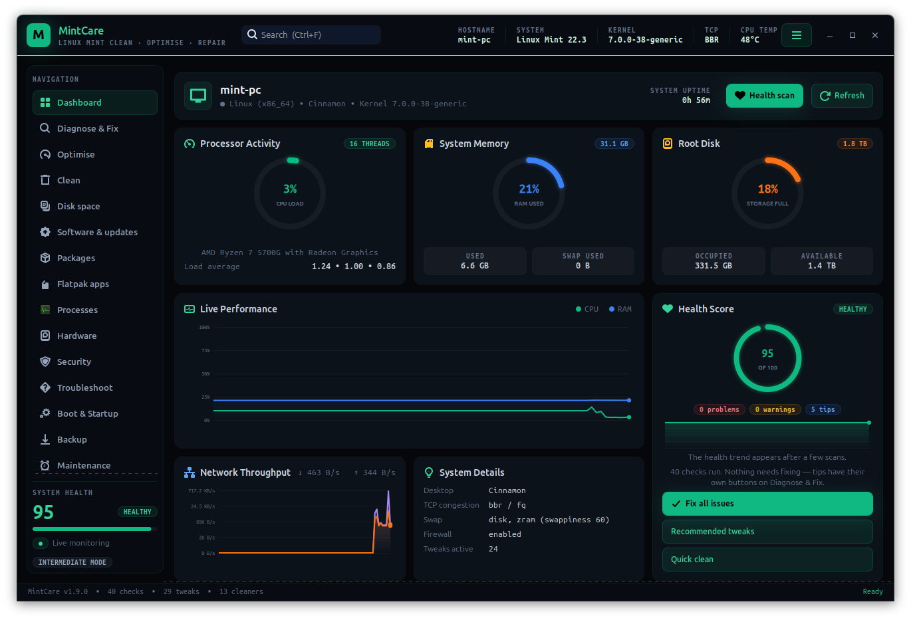
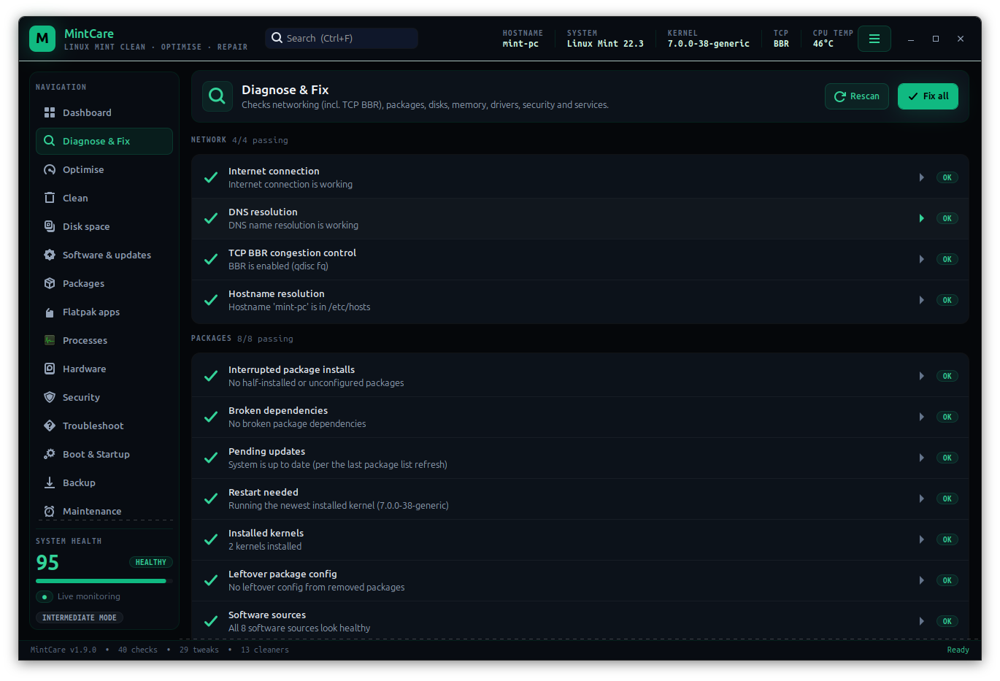
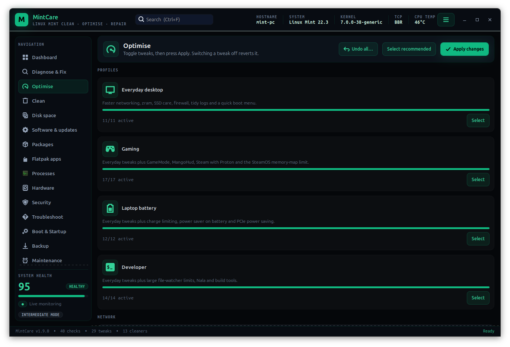
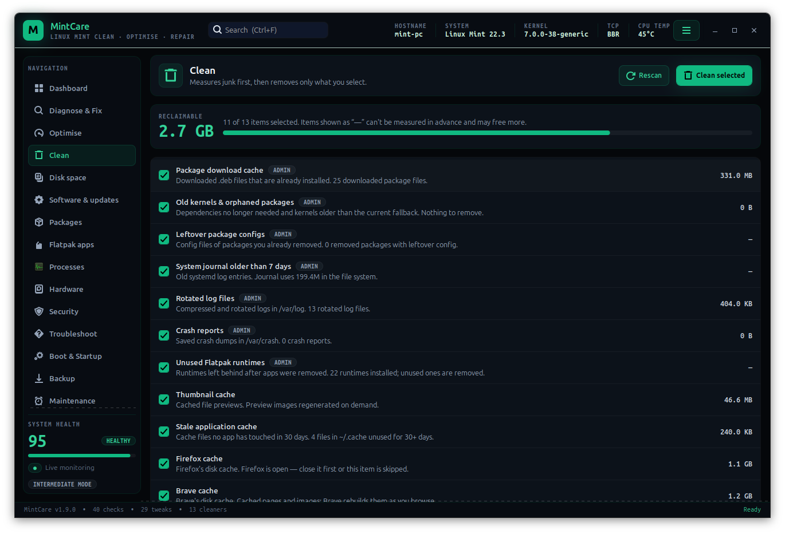

# MintCare

Clean, optimise and repair Linux Mint — a native GTK app (dark, emerald-accented UI in the
style of MintCare Companion) with tweaks in the
spirit of Chris Titus Tech's linutil/winutil, plus a diagnostics engine that
finds and fixes common problems.



| Diagnose & Fix | Optimise | Clean |
|---|---|---|
|  |  |  |

```
./build-deb.sh                                   # builds dist/mintcare_<ver>_all.deb
sudo apt install ./dist/mintcare_1.12.8_all.deb   # system-wide install (recommended)
```
or, without packaging:
```
./install.sh        # adds MintCare to the menu and ~/.local/bin/mintcare
./mintcare.py       # or just run it from here
```

The .deb also installs a polkit action (`org.mintcare.run`) and a small root
helper (`/usr/lib/mintcare/mintcare-root`), so the password prompt names
MintCare. Run from source, it falls back to `pkexec /bin/bash`.

Requires only what Mint ships: Python 3, GTK 3 (python3-gi) and pkexec.

## Interface
* **Themes:** Dark (default), Light, High contrast, or follow the system — header menu (☰).
* **Experience level:** Beginner (essentials and recommended tweaks only), Intermediate, Advanced.
* **Search (Ctrl+F):** pages, checks, tweaks, profiles, cleaners and settings; jumps to the row.
* **Responsive:** the layout reflows down to ~760 px wide; the sidebar collapses to icons.
* **Tray icon:** optional XApp status icon with check-up / quick clean; can start in the tray at login.
* **Health report:** export as PDF or HTML, with personal details removed by default.
* **Languages:** English, Spanish, French, German, Portuguese and Italian (follows your system
  language); see `po/README.md` to add one.
* **Reduced motion:** gauges stop animating when animations are turned off in System Settings.
* **Keyboard:** Ctrl+1…9 jump to sidebar pages, Ctrl+Page Up/Down step through them, F5 refreshes the
  page, Ctrl+E exports a report, Ctrl+? lists every shortcut. Switches, gauges and charts have names
  and live values for screen readers, and the disk-space map works with the arrow keys.

## Pages

| Page | What it does |
|---|---|
| **Dashboard** | Update banner, health-score trend, live CPU / RAM / disk ring gauges, live performance and network charts, health score, system details, one-click *Fix all / Recommended tweaks / Quick clean* |
| **Diagnose & Fix** | 40 checks with a Fix button where a safe fix exists; click any check to see the command behind it and its live output (copy it or open it in a terminal) |
| **Optimise** | 4 one-click profiles (Everyday desktop, Gaming, Laptop battery, Developer) and 29 toggleable tweaks; switching one off reverts it |
| **Disk space** | Clickable treemap of any folder (or the whole system) with the largest files, a content-based duplicate finder (BLAKE2, oldest copy kept) and Timeshift snapshot clean-up. Files go to the Trash; an Old downloads tab lists big files in Downloads untouched for 3 months; restore single files from a Timeshift snapshot (the current one is kept as NAME.~1~) |
| **Software & updates** | MintCare self-update from GitHub (SHA-256 verified); APT source health — never downloaded, wrong Ubuntu series, duplicates, missing keys, apt test run — with disable/enable for third-party sources |
| **Packages** | Largest packages, what you installed, held packages; apt history with *Undo*; kernel manager; mirror speed test and switch (backed up); Mint upgrade check with a readiness list; the upgrade checklist covers disk space, snapshot, updates, PPAs, held and half-installed packages, DKMS drivers and power |
| **Flatpak apps** | Every Flatpak with size, origin and a sandbox rating; Flatseal-style switches (network, home, whole filesystem, Downloads, devices, sound, X11) via per-user overrides; update, repair, uninstall |
| **Clean** | Measures and removes junk |
| **Processes** | Live CPU/RAM list, *What is this?* (with the owning package), end or force-end |
| **Hardware** | Firmware updates via fwupd/LVFS; SMART health per drive (NVMe wear/spare/errors, HDD reallocated/pending/CRC), live temperature tiles, CPU/GPU throttling, full `smartctl -x` report; error counters tracked over time, with a warning when they grow |
| **Security** | Every listening service, whether other computers can reach it, firewall state and rules (admin), program identification, and *Turn off* for risky services (SSH, Samba, RDP, databases…); login audit (failed logins, SSH settings, AppArmor, auto-login, screen lock); ClamAV and rkhunter scans with quarantine; unknown listeners explained (program, package, service) with a keep-or-turn-off suggestion |
| **Troubleshoot** | Sound, network and Wi-Fi (with an internet speed test), printers, Bluetooth and crash reports, each with one-click fixes |
| **Boot & Startup** | Boot timeline (firmware/loader/kernel/services), boot-time history, slowest units with *blocks boot* markers and Disable/Enable for known-safe services, startup-app switches; delay startup apps (10 s, 30 s, 1 min) so the desktop is ready sooner |
| **Backup** | rsync snapshots of chosen folders to another drive (unchanged files hard-linked), schedule, keep N; export/import MintCare settings to move to another PC; restore files, folders or a whole snapshot, keeping anything replaced as NAME.before-restore |
| **Maintenance** | Scheduled check-up (systemd user timer, daily/weekly/monthly) with optional safe cleaning and a desktop notification when something needs attention; safety-snapshot preference (ask / always / never); *Undo all* for every MintCare change; a persistent history timeline |
| **Assistant** | Optional: ask Claude (Anthropic) about your PC, using your own API key. Off until set up; the system summary is opt-in and has names and serial numbers removed. It can run MintCare's read-only checks if you allow it (output scrubbed of names, serials and MAC addresses), thinks harder on request, and shows the cost of each answer |
| **Activity log** | Full output of every command that ran |

### Diagnostics
Network: internet, DNS, **TCP BBR + fq qdisc**, hostname in /etc/hosts ·
Packages: interrupted dpkg, broken deps, pending updates, reboot/kernel mismatch,
kernel count, leftover configs · Storage: disk and /boot space, SSD TRIM, journal
size, Timeshift schedule · Memory: swap/zram, RAM use · Hardware: CPU microcode,
NVIDIA driver (nouveau / none), TLP vs power-profiles-daemon · Security: UFW,
home folder permissions · System: NTP sync, failed system/user services,
disk SMART health, temperatures & throttling, boot time, errors since boot (ignoring sudo password noise), Bluetooth SAP plugin
errors, unused ecryptfs login module, inotify limit.

### Tweaks
BBR · network stack tuning · encrypted DNS · zram · low swappiness · writeback
tuning · SSD TRIM timer · journal cap · Mint auto-removal of old kernels ·
faster shutdown · skip wait-online · UFW firewall · automatic updates ·
microcode · vm.max_map_count for gaming · inotify for IDEs · Nala · essential
tools · TLP conflict fix.

**Gaming:** vm.max_map_count, GameMode (+ group fix), GameMode performance profile,
MangoHud + GOverlay, Steam (Flatpak) with controller rules, ProtonUp-Qt ·
**Laptop:** TLP conflict fix, 80% charge limit, power saver on battery, PCIe ASPM ·
**Storage:** per-drive I/O scheduler (none / mq-deadline / BFQ) ·
**Boot:** shorter GRUB menu and 5 s instead of 30 s after a crash (drop-in, grub.cfg backed up).
**Desktop (your account, no password):** turn off Cinnamon effects and animations; full-screen games skip the compositor.

### Cleaner
APT cache, old kernels/orphans, leftover configs, journal >7 days, rotated logs,
crash reports, unused Flatpak runtimes, per-browser caches (Firefox, Brave, Chrome,
Chromium, Vivaldi, Edge, Opera, LibreWolf; skipped while the browser is open),
thumbnails, stale ~/.cache files,
developer caches (opt-in), data left by removed Flatpak apps and unused Cinnamon
add-ons (opt-in, moved to the Trash), Trash (opt-in).

## How changes are made safely
* Everything runs unprivileged except the actual change, which goes through a
  **single pkexec prompt per batch**.
* Tweaks write only MintCare-owned drop-ins (`/etc/sysctl.d/99-mintcare-*.conf`,
  `/etc/systemd/*.conf.d/99-mintcare*.conf`, …). sysctl tweaks save the previous
  values to `/var/lib/mintcare/` and restore them on revert.
* A tweak is marked applied (`/var/lib/mintcare/applied/<id>`) only if every
  command in it succeeded.
* Settings that are already active on your system (e.g. BBR set by something
  else) show as *already active* and are left alone.

## Safety net
* **Safety snapshots:** before repairs, optimisations, boot-service changes and Undo, MintCare can
  take a Timeshift snapshot first (it won't take another if one was made in the last 30 minutes).
* **Undo all:** reverts any MintCare optimisation, re-enables boot services it disabled, restores
  startup apps and resets Flatpak permissions it changed — you pick what to keep.
* **History:** every change is appended to `~/.local/state/mintcare/history.jsonl`.
* Settings live in `~/.config/mintcare/settings.json`.

## CLI
```
mintcare scan [--fix]
mintcare tweaks [--apply ID... | --apply recommended | --apply profile:gaming | --revert ID...]
mintcare clean [--run [ID...]]
mintcare hardware          # drives, temperatures, boot time
mintcare space [PATH]      # biggest folders/files and snapshot count
mintcare maintain [--no-notify]  # what the scheduled check-up runs
mintcare backup            # back up your folders now (what the backup timer runs)
mintcare report [-o FILE] [--personal]  # HTML health report
mintcare --tray            # start the GUI hidden in the tray
```

## Development
```
./run-tests.sh                 # 91 stdlib unittest tests; never needs root or changes the system
po/update-pot.sh               # refresh the translation template (see po/README.md)
```
See `RELEASING.md` for GitHub releases and a Launchpad PPA.

## Adding checks or tweaks
Add a `Check` to `mintcare/checks.py`, a `Tweak` (or `sysctl_tweak`) to
`mintcare/tweaks.py`, or a `CleanItem` to `mintcare/cleaner.py`; the GUI and CLI
pick them up automatically.

## Licence
MintCare is free software, released under the
[GNU General Public License v3.0 or later](LICENSE). Copyright © 2026 Matthew Allwood.
